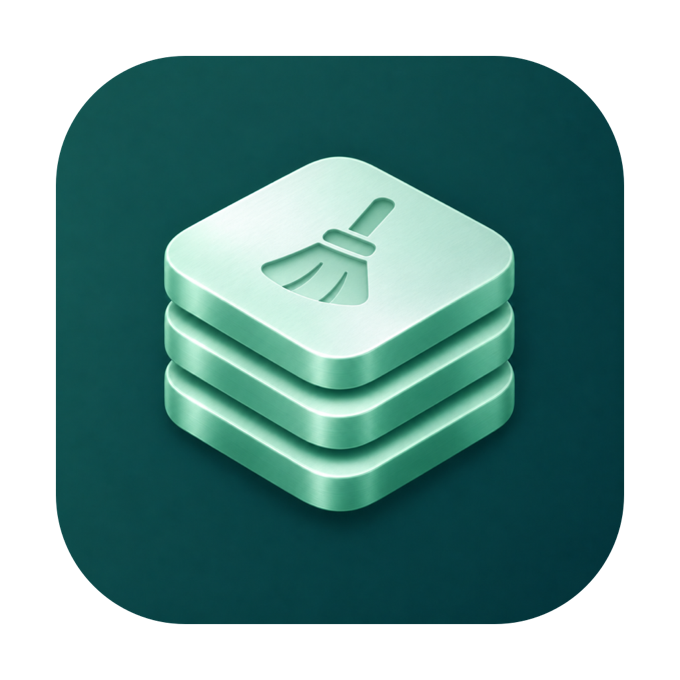
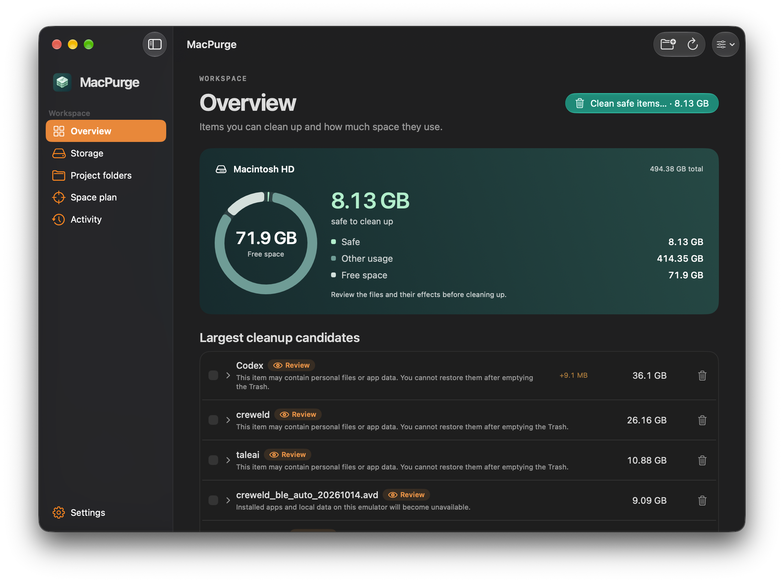
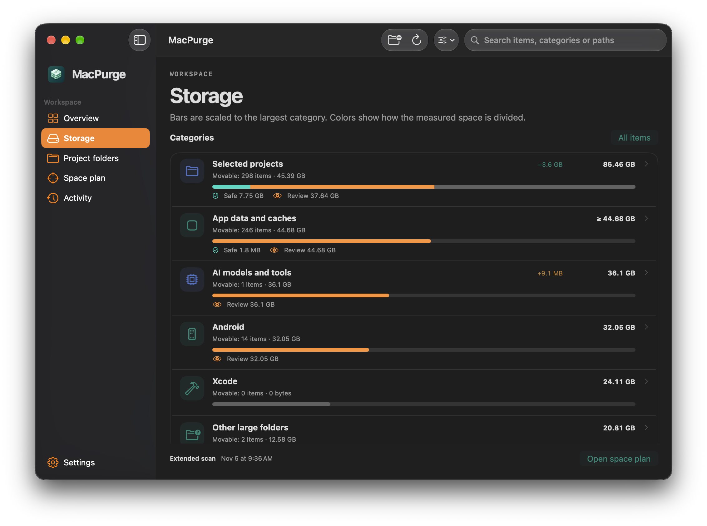

# MacPurge

<p align="center">
  
</p>

**Native macOS storage analysis and reviewed cleanup.** Find out what is using your disk space, inspect project outputs and caches, and choose what to clean up from one workspace.

<p align="center">
  <a href="https://github.com/burakereno/macpurge/releases/latest/download/MacPurge.dmg">
    
  </a>
  &nbsp;
  <a href="https://github.com/burakereno/macpurge/releases/latest">
    
  </a>
</p>

<p align="center">
  <sub>macOS 14.0+ · Intel and Apple Silicon · Developer ID signed and notarized</sub>
</p>

<p align="center">
  <a href="https://macpurge.burakerenoglu.com">macpurge.burakerenoglu.com</a>
</p>

<p align="center">
  
  <br>
  <sub>Overview — disk usage, free space and the largest cleanup candidates.</sub>
</p>

<p align="center">
  
  <br>
  <sub>Storage — category totals, changes since the previous scan and cleanup breakdowns.</sub>
</p>

## Features

- **Disk overview** — see total capacity, free space, other usage and the estimated space available from supported Safe cleanup actions.
- **Storage browser** — explore category totals and Safe/Review breakdowns, then open item cards with search, sorting and file details. App Caches has its own category.
- **Explainable inventory** — inspect what data is, which tool created it, the evidence behind a review suggestion, and the effect of removal. Explanations use saved scan evidence and preserve uncertainty about missing projects and last use.
- **Editor and AI tool data** — extended scans distinguish supported editor workspaces and extension registry leftovers, plus Claude/Codex logs, caches, settings, checkpoints and conversation history. New personal-data findings are inspection-only.
- **Uninstall Apps** — compare installed app bundles and recognized data using the latest extended scan. Open an app to choose files and move them to the Trash. Allocated totals deduplicate hard links and mark partial measurements.
- **Duplicates** — open Duplicates in the sidebar and choose a folder. Bounded content comparisons find matching files of at least 1 MB, skipping application data and dependencies. Reviewed Trash actions retain a verified copy and recheck its contents. Shared or unknown clone allocation is excluded from estimated recovery.
- **Docker objects** — open Docker Manager from the Docker category in Storage to inspect containers, images, volumes and build cache. Separate permanent-operation previews support stopped containers, unused images and individual unused, unshared cache records. Volumes and forced removals are excluded. Operation receipts are recorded locally.
- **Tool versions** — extended scans show metadata-backed defaults and older numeric versions for nvm, pyenv, rbenv and Homebrew, plus Rust's default toolchain. These findings are inspection-only and include the relevant manager's review command.
- **Download suggestions** — with protected-location scanning enabled, inspect recognized installers, uncertain installed-app matches and content-verified repeat downloads. These suggestions are inspection-only.
- **Ollama leftovers** — distinguish unreferenced model blobs and partial downloads. Reviewed Trash actions require complete, readable manifests, a stable file at least 72 hours old and an idle Ollama process; references are checked again before execution.
- **Project folders** — choose project roots, discover supported build outputs and dependency folders, and review the cost of rebuilding or downloading them again.
- **Space planning** — set a cleanup target, inspect the proposed candidates and see when the available actions cannot reach it.
- **Quick and extended scans** — scan known locations, follow progress, cancel a scan and inspect partial or unavailable measurements.
- **Cleanup previews and restore** — review supported file removals before moving them to the Trash, then find their restore options in Space plan.
- **Scan exclusions** — choose folders to skip, including everything inside them, in both quick and extended scans.
- **History retention** — keep scan records for 30 days, 90 days or forever; restore records are retained separately.
- **Dock and menu bar access** — use either or both, keep the app available after closing its window, and optionally launch it at login.
- **Menu bar shortcuts** — left-click the icon to open MacPurge; right-click or Control-click to open its menu.
- **Live menu bar capacity** — optionally display free space, a usage ring or both in Settings. Volume capacity refreshes every 30 seconds while the menu extra is visible, without scanning files. Icon-only remains the default.
- **Optional notifications** — configure low-space thresholds, significant growth alerts and weekly summaries.
- **Widgets and Shortcuts** — view the last completed disk summary and use read-only intents for saved measurements and space-plan previews.
- **JSON export and CLI** — export scan reports or generate a read-only cleanup plan from the app's command-line entry point.
- **Verified in-app updates** — check GitHub Releases and install a matching signed release after manifest, checksum, publisher and Gatekeeper validation.
- **Native macOS** — SwiftUI and AppKit, keyboard navigation and nine interface languages: English, Turkish, German, French, Spanish, Japanese, Simplified Chinese, Korean and Russian.

### Storage coverage

| Area | What MacPurge inventories |
| --- | --- |
| Development | Xcode data, simulator devices and runtimes, package caches, developer tools and selected project folders |
| AI tools | Local model files, model caches and supported AI application data |
| Containers and virtual machines | Docker storage and supported local virtual-machine locations |
| Android | SDK components, emulators and Android Studio data |
| Apps and media | Application data, recognized caches and media-library locations |
| macOS storage | Logs, temporary files, device backups, Trash, shared data, Time Machine snapshots and system-managed locations |
| Other large folders | Large subfolders found within supported scan locations and selected project roots |

Inventory coverage does not mean every item can be deleted. Availability, permissions, ownership and the item's data type determine which actions are offered.

### Cleanup behavior

MacPurge distinguishes measured folder sizes, estimated reclaimable space and the disk's current free space. Rebuildable caches and verified outputs are assessed separately from personal data and system-managed content.

Supported file removals move files to the Trash with restore records. In Uninstall Apps, the Remove button applies the selection shown on screen. Other cleanup flows show a preview before moving files. Tool-specific permanent operations have their own explicit confirmation. Files in the Trash continue to occupy disk space until the Trash is emptied.

Duplicate searches compare at most 250,000 candidate files within a 64 GB hashing budget. Results describe the verified scope; a size or version difference alone is never proof that a file is no longer needed. Duplicate Trash actions are limited to eligible personal folders inside the user's home directory. Docker removals cannot be restored by MacPurge, and Docker-reported recovery is separate from macOS free space. Docker operation records are stored in `DockerActions.jsonl` in the app's local support directory.

Scan history and restore journals are stored locally on your Mac. Update checks and downloads contact GitHub.

## Installation

### Download DMG

1. Go to the [Releases](https://github.com/burakereno/macpurge/releases/latest) page.
2. Download **`MacPurge.dmg`**.
3. Open the DMG and drag **MacPurge.app** into your **Applications** folder.

Double-click MacPurge to launch it. The release app and DMG are Developer ID signed, notarized by Apple and stapled. The same download supports Intel and Apple Silicon Macs running macOS 14.0 or later.

Start with a quick scan, or add folders in **Project folders**. Use an extended scan for broader coverage. Configure excluded folders, history retention, Dock/menu bar visibility and updates in **Settings**.

macOS may request access to Downloads, Trash, device backups and application containers when you choose to include protected locations in an extended scan. Inaccessible locations are reported in the scan results.

## Build from Source

### Requirements

- macOS 14.0+
- Xcode 26 or later with Swift 6.2+
- XcodeGen

### Steps

```bash
git clone https://github.com/burakereno/macpurge.git
cd macpurge

brew install xcodegen
swift test
./script/build_and_run.sh
```

The run script builds and launches **`dist/MacPurge Dev.app`**, with an orange **DEV** icon badge and the bundle identifier `com.burakerenoglu.macpurge.dev`. Its preferences, history, Trash receipts and widget data are separate from the release app. Xcode's Run action also uses the Development configuration.

Production archives and GitHub releases use the normal MacPurge identity and icon. Development builds cannot install production updates over themselves. See [release instructions](docs/releasing.md) for the signing, notarization and DMG workflow.

## Tech Stack

- **Swift 6** — storage inventory, measurements and cleanup policy
- **SwiftUI + AppKit** — native workspace, tables, menus and app lifecycle
- **Swift Charts** — disk usage and storage trends
- **SQLite** — local scan history
- **WidgetKit + App Intents** — disk-summary widgets and Shortcuts integration
- **Swift Package Manager + XcodeGen** — tests and Xcode project generation
- **GitHub Actions** — universal builds, Developer ID signing, notarization and release publication

Update metadata lives in [`.github/release-contract.env`](.github/release-contract.env). Downloads are checked against the release manifest and SHA-256, and the downloaded app's publisher is verified against the expected Developer ID team. The updater keeps the previous app until the replacement is observed running.
